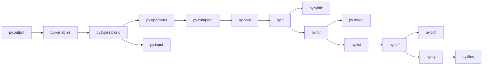

# Ruta de Python — Temario / Python Path — Syllabus

Meta / Goal: de cero a escribir programas pequeños con funciones, colecciones y archivos.
From zero to writing small programs with functions, collections and files.

Cada unidad = 4–6 lecciones de 5–10 min. Cada lección = 1 concepto + 5–8 ejercicios.
Each unit = 4–6 lessons of 5–10 min. Each lesson = 1 concept + 5–8 exercises.

| # | Unidad (ES) | Unit (EN) | Habilidades (skill ids) |
|---|---|---|---|
| 1 | Primeros pasos | First steps | `py.output`, `py.variables`, `py.types.basic` |
| 2 | Operaciones y entrada | Operations and input | `py.operators`, `py.input`, `py.strings.basic` |
| 3 | Decisiones | Decisions | `py.bool`, `py.if`, `py.compare` |
| 4 | Repetición | Loops | `py.while`, `py.for`, `py.range` |
| 5 | Listas | Lists | `py.list`, `py.index`, `py.list.methods` |
| 6 | Funciones | Functions | `py.def`, `py.params`, `py.return`, `py.scope` |
| 7 | Diccionarios y tuplas | Dicts and tuples | `py.dict`, `py.tuple`, `py.set` |
| 8 | Cadenas en profundidad | Strings in depth | `py.strings.methods`, `py.fstring`, `py.slicing` |
| 9 | Errores y depuración | Errors and debugging | `py.errors.read`, `py.try`, `py.debug` |
| 10 | Archivos y proyecto final | Files and capstone | `py.files`, `py.modules`, `py.project` |

## Grafo de habilidades (prerrequisitos) / Skill graph

Regla de desbloqueo / Unlock rule: una lección se abre al completar la anterior
**y** tener dominio ≥ 60 % en las habilidades prerrequisito. Un "test para saltar"
permite abrir una unidad por mérito.

## Errores frecuentes que se etiquetan (`error_tags`)

`syntax.missing_colon`, `syntax.unclosed_string`, `name.undefined`, `name.typo`,
`type.str_plus_int`, `indent.wrong`, `logic.off_by_one`, `logic.assign_vs_compare`,
`io.print_vs_return`, `io.input_not_cast`.

## Principios pedagógicos / Pedagogical principles

1. Un concepto nuevo por lección. / One new concept per lesson.
2. Ejemplo resuelto → ejercicio guiado → ejercicio libre. / Worked example → guided → free.
3. Los ejercicios de unidades anteriores reaparecen espaciados (repaso).
4. Los mensajes de error explican la causa, no solo el síntoma.
5. XP por resolver y por repasar con éxito; nunca por repetir lo ya dominado.
